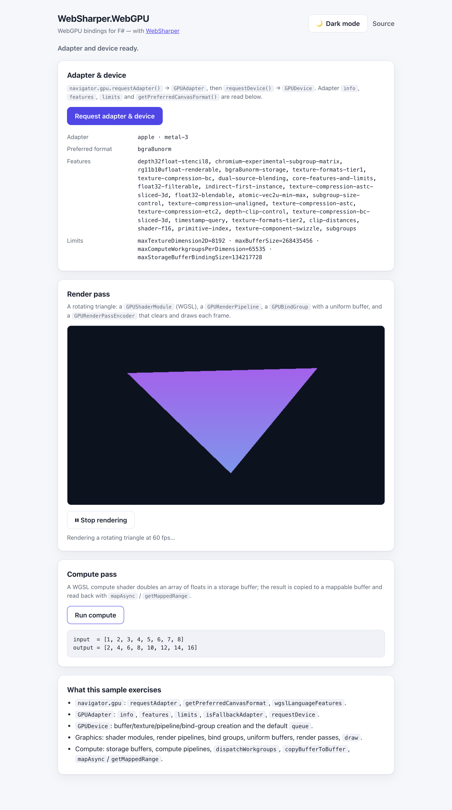

# WebSharper.WebGPU

[](https://www.nuget.org/packages/WebSharper.WebGPU)

An F# [WebSharper](https://websharper.com/) binding for the
[WebGPU API](https://developer.mozilla.org/en-US/docs/Web/API/WebGPU_API) — modern,
low-level access to the GPU for graphics and compute, from F# and C# web apps:

- **Graphics**: shader modules (WGSL), render pipelines, bind groups, render passes,
  textures and samplers.
- **Compute**: compute pipelines, storage buffers, `dispatchWorkgroups`, and buffer
  readback with `mapAsync`/`getMappedRange`.
- **Adapter/device**: `requestAdapter`, `requestDevice`, and the adapter's `info`,
  `features` and `limits`.
- **Canvas**: `GPUCanvasContext` with `configure`/`getCurrentTexture`.

WebGPU is only available in [secure contexts](https://developer.mozilla.org/en-US/docs/Web/Security/Defenses/Secure_Contexts)
(HTTPS or localhost) and in browsers that ship it (current Chrome/Edge, Safari 26+,
and Firefox behind a flag). The sample degrades gracefully when `navigator.gpu` is
missing.

## Repository structure

| Project | Description |
| --- | --- |
| `WebSharper.WebGPU` | The binding (`netstandard2.0`): WIG definitions for the `GPU*` types. |
| `WebSharper.WebGPU.Sample` | Static SPA sample, built with esbuild into `dist/`. |

## Live demos

**Try it live:** [Open the sample in your browser](https://dotnet-websharper.github.io/WebGPU/)



The sample doubles as the binding's [test case](#running-the-sample): it reads the
adapter's `info`, `features`, `limits` and preferred canvas format, renders a
rotating triangle with a render pipeline, and runs a compute shader that doubles an
array of floats in a storage buffer.

## Install

```bash
dotnet add package WebSharper.WebGPU
```

or, in Paket:

```
nuget WebSharper.WebGPU
```

## Usage

The binding models `navigator.gpu` as the `GPU` type, but it does not inject
`navigator.gpu` into core's `Navigator` (that would be a cross-assembly type
extension). Reach the globals with a small inline:

```fsharp
open WebSharper
open WebSharper.JavaScript
open WebSharper.WebGPU

[<Inline "navigator.gpu">]
let gpu () : GPU = X<GPU>

[<Inline "$canvas.getContext('webgpu')">]
let webgpuContext (canvas: HTMLCanvasElement) : GPUCanvasContext = X<GPUCanvasContext>

[<JavaScript>]
let draw () =
    promise {
        let! adapter = gpu().RequestAdapter()
        let! device = adapter.RequestDevice()

        let canvas = JS.Document.GetElementById("canvas") |> As<HTMLCanvasElement>
        let context = webgpuContext canvas
        let format = gpu().GetPreferredCanvasFormat()

        context.Configure(GPUCanvasConfiguration(
            device = device,
            format = format,
            AlphaMode = AlphaMode.Opaque))

        let shader = device.CreateShaderModule(GPUShaderModuleDescriptor(code = """
            @vertex
            fn vs_main(@builtin(vertex_index) i : u32) -> @builtin(position) vec4<f32> {
                var p = array<vec2<f32>, 3>(vec2<f32>(0.0, 0.6), vec2<f32>(-0.6, -0.5), vec2<f32>(0.6, -0.5));
                return vec4<f32>(p[i], 0.0, 1.0);
            }
            @fragment
            fn fs_main() -> @location(0) vec4<f32> { return vec4<f32>(0.4, 0.3, 0.9, 1.0); }
        """))

        let pipeline = device.CreateRenderPipeline(GPURenderPipelineDescriptor(
            layout = "auto",
            vertex = VertexObject(entryPoint = "vs_main", ``module`` = shader),
            Fragment = FragmentObject(
                entryPoint = "fs_main",
                ``module`` = shader,
                Targets = [| ColorTargetState(format = format) |]),
            Primitive = PrimitiveObject(Topology = Topology.Triangle_list)))

        let encoder = device.CreateCommandEncoder()
        let view = context.GetCurrentTexture().CreateView()
        let pass = encoder.BeginRenderPass(RenderPassDescriptor(
            ColorAttachments = [|
                ColorAttachmentObject(
                    loadOp = LoadOp.Clear,
                    storeOp = StoreOp.Store,
                    view = view,
                    ClearValue = Colors(r = 0.05, g = 0.07, b = 0.12, a = 1.0))
            |]))
        pass.SetPipeline(pipeline)
        pass.Draw(3)
        pass.End()
        device.Queue.Submit([| encoder.Finish() |])
    }
```

### Compute

```fsharp
let! _ = device.Queue.OnSubmittedWorkDone()
let encoder = device.CreateCommandEncoder()
let pass = encoder.BeginComputePass()
pass.SetPipeline(computePipeline)
pass.SetBindGroup(0, bindGroup)
pass.DispatchWorkgroups(8)
pass.End()
encoder.CopyBufferToBuffer(output, 0, readback, 0, byteSize)
device.Queue.Submit([| encoder.Finish() |])

do! readback.MapAsync(GPUMapMode.READ)
let result = Float32Array(readback.GetMappedRange())
readback.Unmap()
```

## Notes on the API

- **`module` is a keyword.** `GPUProgrammableStage`, `VertexObject` and
  `FragmentObject` take the shader module in a field named `module`, so pass it with
  a backtick-escaped named argument: `` VertexObject(entryPoint = "vs_main", ``module`` = shader) ``.
- **Flag masks are `int`.** `GPUShaderStage`, `GPUBufferUsage`, `GPUTextureUsage` and
  `GPUColorWrite` values are plain `int` constants so they combine with F#'s `|||`,
  e.g. `GPUShaderStage.VERTEX ||| GPUShaderStage.FRAGMENT` or
  `GPUBufferUsage.STORAGE ||| GPUBufferUsage.COPY_DST`.
- **Hyphenated enum values.** WIG capitalizes only the first letter, so string enums
  with hyphens surface with an underscore: `Topology.Triangle_list`,
  `GPUBufferBindingType.Read_only_storage`, `GPUStorageTextureAccess.Write_only`.
- **`constants`** on a programmable stage is typed `obj` (a plain JavaScript
  dictionary keyed by constant name) — pipeline-overridable constants are declared
  per shader, so there is no fixed record for them.
- **`GPUAdapter.info`** is the current property; `requestAdapterInfo()` was removed
  from the spec and is kept only as an obsolete member.
- **`adapter.requestAdapter()` may return `null`** (no suitable adapter). The binding
  keeps the reference types, so check with `isNull (box x)`.
- **`GPUDevice.lost`** is a `Promise<GPUDeviceLostInfo>`; error scopes are entered
  with `pushErrorScope(filter)` and awaited with `popErrorScope()`.
- **Secure context:** WebGPU is only exposed over HTTPS or on localhost.

## Running the sample

The sample is a static SPA. Build it, then serve `dist/`:

```bash
dotnet tool install -g dotnet-serve   # once
dotnet tool restore && dotnet paket restore
dotnet build WebSharper.WebGPU.Sample/WebSharper.WebGPU.Sample.fsproj -c Release
dotnet serve -d dist -p 5792
```

Open <http://localhost:5792/>. The page:

- requests an adapter and device and shows `adapter.info`, the preferred canvas
  format, every advertised `features` entry, and a selection of `limits`;
- renders a rotating gradient triangle each frame, exercising `GPUShaderModule`,
  `GPURenderPipeline`, `GPUBindGroup` + a uniform buffer written with
  `queue.writeBuffer`, a `GPURenderPassEncoder` and `draw`;
- runs a compute shader that doubles `[1 … 8]` in a storage buffer and reads it back
  with `mapAsync`/`getMappedRange`, printing the output `[2, 4, 6, 8, 10, 12, 14, 16]`.

Headless Chrome needs `--enable-unsafe-webgpu` (and on macOS `--use-angle=metal`);
the screenshot above was captured that way.

## Build from source

Prerequisites: the .NET 11 SDK (the WebSharper 11 compiler runs on the .NET 11
runtime) and Node.js.

```bash
git clone https://github.com/dotnet-websharper/WebGPU.git
cd WebGPU

# dependencies are managed by Paket
dotnet tool restore
dotnet paket restore

# the binding
dotnet build WebSharper.WebGPU/WebSharper.WebGPU.fsproj -c Release

# the sample: WebSharper output goes to WebSharper.WebGPU.Sample/build,
# then esbuild bundles it into dist/
dotnet build WebSharper.WebGPU.Sample/WebSharper.WebGPU.Sample.fsproj -c Release

dotnet serve -d dist -p 5792
```

## Pack

```bash
dotnet fsi ./build.fsx -t WS-Package
```

The resulting `WebSharper.WebGPU.nupkg` contains the binding assembly (with its
WebSharper metadata sidecar), the XML documentation and the package dependencies.

## Deployment

`.github/workflows/ghpages.yml` builds the sample in Release and publishes `dist/`
to the `gh-pages` branch with `peaceiris/actions-gh-pages`. The deploy runs only
from the default branch.

## Repository layout

```
WebSharper.WebGPU/                 # the binding (WIG definitions)
  Main.fs
WebSharper.WebGPU.Sample/          # static SPA demo
  Client.fs
  index.html
  site.css
  esbuild.config.mjs
.github/workflows/ghpages.yml      # build + deploy the sample to GitHub Pages
nuget/WebSharper.WebGPU.paket.template
paket.dependencies
```

## License

Apache 2.0 — see [LICENSE.md](LICENSE.md). The WebGPU API itself is a
[W3C specification](https://www.w3.org/TR/webgpu/); the binding ships no upstream
source.
